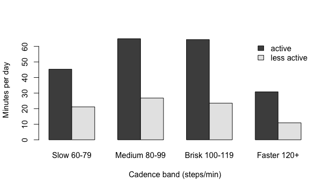

<!-- README.md is generated from README.Rmd. Please edit that file -->

# stepcadence

<!-- badges: start -->

[](https://github.com/jhuwit/stepcadence/actions/workflows/R-CMD-check.yaml)
[](https://app.codecov.io/gh/jhuwit/stepcadence)
<!-- badges: end -->

`stepcadence` calculates cadence (steps per minute) metrics from
minute-level step count data, such as data from wearable devices or the
National Health and Nutrition Examination Survey (NHANES). The metrics
follow [Tudor-Locke et
al. (2018)](https://doi.org/10.1136/bjsports-2017-097628).

## Overview

Cadence is a simple, interpretable measure of the intensity of walking:
about 100 steps/min corresponds to moderate intensity in adults. From a
day of minute-by-minute step counts, `stepcadence` computes:

| Function | Metrics |
|----|----|
| `summarize_cadence()` | All of the metrics below, one row per group |
| `compute_daily_steps()` | Total steps, stepping time (minutes with steps), and mean cadence while stepping |
| `compute_cadence_peak()` | Peak 1-, 30-, and 60-minute cadence: the mean of the highest, *not necessarily consecutive*, minutes |
| `compute_cadence_max()` | Maximum 5-, 20-, 30-, and 60-minute cadence: the highest mean over *consecutive* minutes |
| `compute_cadence_mean()` | Uncensored and censored mean cadence, and minutes of wear |
| `compute_cadence_level()` | Minutes at low, moderate, and high cadence (default cut points 100 and 130 steps/min, the CADENCE-Adults moderate and vigorous thresholds) |
| `compute_cadence_minutes_above()` | Minutes at or above 40 and 100 steps/min (purposeful and moderate-or-higher) |
| `compute_cadence_bouts()` | Number of, minutes in, and cadence of sustained bouts (default 10+ minutes at 100+ steps/min) |
| `compute_cadence_extended_bout()` | Extended bout cadence: mean cadence in bouts of 2+ minutes at 60+ steps/min (Saint-Maurice et al., 2020) |
| `cadence_thresholds()` | Age-specific CADENCE moderate and vigorous thresholds |
| `step_volume_category()` | Steps/day categories (sedentary to highly active) |
| `compute_cadence_bands()`, `summarize_cadence_bands()` | Minutes in each cadence band: 0, 1-19, 20-39, 40-59, 60-79, 80-99, 100-119, and 120+ steps/min. `zero` is exactly 0; any value above 0, even 0.5, is incidental (see [Individual metrics](#individual-metrics)) |

The input is a data frame with one row per minute and columns:

- `time`: the minute, as a number or a date-time (`POSIXct`), increasing
  by exactly 1 minute with no gaps;
- `steps`: the steps taken in that minute (`NA` allowed);
- `wear` (optional): `TRUE`/1 if the device was worn. With
  `mask_wear = TRUE`, non-wear minutes are excluded from every metric;
- `counts` (optional): activity counts per minute, used for censored
  mean cadence.

Use `group_cols` (or `dplyr::group_by()`) to compute metrics separately
for each participant, day, or other unit.

## Installation

You can install the development version of `stepcadence` from
[GitHub](https://github.com/jhuwit/stepcadence) with:

``` r
# install.packages("remotes")
remotes::install_github("jhuwit/stepcadence")
```

## Quick start

The package includes `simulated_nhanes_steps`: 3 participants (`SEQN`)
with 2 days (`PAXDAYM`) of 1440 minutes each.

``` r
library(stepcadence)
head(simulated_nhanes_steps)
#>   SEQN PAXDAYM time steps
#> 1 ID_1       1    1     0
#> 2 ID_1       1    2     0
#> 3 ID_1       1    3     0
#> 4 ID_1       1    4     0
#> 5 ID_1       1    5     0
#> 6 ID_1       1    6     0
```

`summarize_cadence()` computes every metric. Here we compute them for
each participant-day, using `nhanes_group_cols()` (`SEQN` and
`PAXDAYM`):

``` r
result = summarize_cadence(simulated_nhanes_steps,
                           group_cols = nhanes_group_cols())
result
#> # A tibble: 6 × 35
#>   SEQN  PAXDAYM total_steps n_minutes_stepping mean_stepping_cadence peak_1min
#>   <chr>   <int>       <dbl>              <int>                 <dbl>     <dbl>
#> 1 ID_1        1       15150                130                  117.       200
#> 2 ID_1        2       15150                130                  117.       200
#> 3 ID_2        1       15150                130                  117.       200
#> 4 ID_2        2       15150                130                  117.       200
#> 5 ID_3        1       15150                130                  117.       200
#> 6 ID_3        2       15150                130                  117.       200
#>   peak_30min peak_60min n_minutes n_minutes_wear n_minutes_valid
#>        <dbl>      <dbl>     <int>          <int>           <int>
#> 1        200        165      1440             NA            1440
#> 2        200        165      1440             NA            1440
#> 3        200        165      1440             NA            1440
#> 4        200        165      1440             NA            1440
#> 5        200        165      1440             NA            1440
#> 6        200        165      1440             NA            1440
#>   mean_uncensored_cadence mean_censored_cadence max_5min max_20min max_30min
#>                     <dbl>                 <dbl>    <dbl>     <dbl>     <dbl>
#> 1                    10.5                    NA      200       200       200
#> 2                    10.5                    NA      200       200       200
#> 3                    10.5                    NA      200       200       200
#> 4                    10.5                    NA      200       200       200
#> 5                    10.5                    NA      200       200       200
#> 6                    10.5                    NA      200       200       200
#>   max_60min low_cadence moderate_cadence high_cadence minutes_40plus
#>       <dbl>       <int>            <int>        <int>          <int>
#> 1       100        1345               60           35            127
#> 2       100        1345               60           35            127
#> 3       100        1345               60           35            127
#> 4       100        1345               60           35            127
#> 5       100        1345               60           35            127
#> 6       100        1345               60           35            127
#>   minutes_100plus n_bouts bout_minutes mean_bout_cadence n_extended_bouts
#>             <int>   <int>        <int>             <dbl>            <int>
#> 1              95       3           90               140                4
#> 2              95       3           90               140                4
#> 3              95       3           90               140                4
#> 4              95       3           90               140                4
#> 5              95       3           90               140                4
#> 6              95       3           90               140                4
#>   extended_bout_cadence  zero incidental sporadic purposeful slow_walk
#>                   <dbl> <int>      <int>    <int>      <int>     <int>
#> 1                  142.  1310          1        2         32         0
#> 2                  142.  1310          1        2         32         0
#> 3                  142.  1310          1        2         32         0
#> 4                  142.  1310          1        2         32         0
#> 5                  142.  1310          1        2         32         0
#> 6                  142.  1310          1        2         32         0
#>   medium_walk brisk_walk faster_ambulation
#>         <int>      <int>             <int>
#> 1           0         30                65
#> 2           0         30                65
#> 3           0         30                65
#> 4           0         30                65
#> 5           0         30                65
#> 6           0         30                65
```

A single day of data needs no grouping:

``` r
one_day = subset(simulated_nhanes_steps, SEQN == "ID_1" & PAXDAYM == 1)
summarize_cadence(one_day)
#> # A tibble: 1 × 33
#>   total_steps n_minutes_stepping mean_stepping_cadence peak_1min peak_30min
#>         <dbl>              <int>                 <dbl>     <dbl>      <dbl>
#> 1       15150                130                  117.       200        200
#>   peak_60min n_minutes n_minutes_wear n_minutes_valid mean_uncensored_cadence
#>        <dbl>     <int>          <int>           <int>                   <dbl>
#> 1        165      1440             NA            1440                    10.5
#>   mean_censored_cadence max_5min max_20min max_30min max_60min low_cadence
#>                   <dbl>    <dbl>     <dbl>     <dbl>     <dbl>       <int>
#> 1                    NA      200       200       200       100        1345
#>   moderate_cadence high_cadence minutes_40plus minutes_100plus n_bouts
#>              <int>        <int>          <int>           <int>   <int>
#> 1               60           35            127              95       3
#>   bout_minutes mean_bout_cadence n_extended_bouts extended_bout_cadence  zero
#>          <int>             <dbl>            <int>                 <dbl> <int>
#> 1           90               140                4                  142.  1310
#>   incidental sporadic purposeful slow_walk medium_walk brisk_walk
#>        <int>    <int>      <int>     <int>       <int>      <int>
#> 1          1        2         32         0           0         30
#>   faster_ambulation
#>               <int>
#> 1                65
```

## Individual metrics

Each group of metrics can also be computed on its own.

**Peak cadence** is the mean of the highest minutes of the day, wherever
they occur:

``` r
compute_cadence_peak(one_day)
#> # A tibble: 1 × 3
#>   peak_1min peak_30min peak_60min
#>       <dbl>      <dbl>      <dbl>
#> 1       200        200        165
```

**Maximum cadence** is the highest mean over *consecutive* minutes. The
two differ when the most active minutes are spread out. In this toy day,
the 30 highest minutes are 100 steps/min, but they occur in two
15-minute walks, so the best 30 consecutive minutes average only 50
steps/min:

``` r
walks = data.frame(
  time = 1:120,
  steps = c(rep(100, 15), rep(0, 50), rep(100, 15), rep(0, 40))
)
compute_cadence_peak(walks)
#> # A tibble: 1 × 3
#>   peak_1min peak_30min peak_60min
#>       <dbl>      <dbl>      <dbl>
#> 1       100        100         50
compute_cadence_max(walks)
#> # A tibble: 1 × 4
#>   max_5min max_20min max_30min max_60min
#>      <dbl>     <dbl>     <dbl>     <dbl>
#> 1      100        75        50        25
```

**Mean cadence** is total steps divided by minutes with data. If
activity `counts` are available, the censored mean also sets steps to 0
in minutes with fewer than `counts_threshold` counts (500 by default).
Here the second walk has low counts, so its steps are censored and the
censored mean is half the uncensored mean:

``` r
walks$counts = c(rep(1500, 15), rep(0, 50), rep(300, 15), rep(0, 40))
compute_cadence_mean(walks)
#> # A tibble: 1 × 5
#>   n_minutes n_minutes_wear n_minutes_valid mean_uncensored_cadence
#>       <int>          <int>           <int>                   <dbl>
#> 1       120             NA             120                      25
#>   mean_censored_cadence
#>                   <dbl>
#> 1                  12.5
```

**Cadence bands** label each minute, and `summarize_cadence_bands()`
counts the minutes in each band:

| Band                | Steps/min | Values included           |
|---------------------|-----------|---------------------------|
| `zero`              | 0         | **exactly 0**             |
| `incidental`        | 1-19      | above 0 and below 20      |
| `sporadic`          | 20-39     | 20 or more and below 40   |
| `purposeful`        | 40-59     | 40 or more and below 60   |
| `slow_walk`         | 60-79     | 60 or more and below 80   |
| `medium_walk`       | 80-99     | 80 or more and below 100  |
| `brisk_walk`        | 100-119   | 100 or more and below 120 |
| `faster_ambulation` | 120+      | 120 or more               |

Every band except `zero` is a range that includes its lower bound and
goes up to, but not including, the next band’s lower bound, so 19.5 is
`incidental` and 20 is `sporadic`. Values are not rounded.

`zero` is different: it is a single value, not a range. It means no
movement, so only exactly 0 is `zero`. Any value above 0, even one below
1 such as 0.5 or 0.001, counts as movement and is `incidental`. If your
step counts can contain tiny non-zero values (for example from
imputation or averaging) that should count as no movement, round them
before computing bands.

``` r
df = data.frame(steps = c(0, 0.001, 0.5, 1, 19.5, 20, 45, 65, 85, 105, 125))
compute_cadence_bands(df)
#>      steps      cadence_band
#> 1    0.000              zero
#> 2    0.001        incidental
#> 3    0.500        incidental
#> 4    1.000        incidental
#> 5   19.500        incidental
#> 6   20.000          sporadic
#> 7   45.000        purposeful
#> 8   65.000         slow_walk
#> 9   85.000       medium_walk
#> 10 105.000        brisk_walk
#> 11 125.000 faster_ambulation

compute_cadence_bands(simulated_nhanes_steps) |>
  summarize_cadence_bands(group_cols = nhanes_group_cols())
#> # A tibble: 6 × 10
#>   SEQN  PAXDAYM  zero incidental sporadic purposeful slow_walk medium_walk
#>   <chr>   <int> <int>      <int>    <int>      <int>     <int>       <int>
#> 1 ID_1        1  1310          1        2         32         0           0
#> 2 ID_1        2  1310          1        2         32         0           0
#> 3 ID_2        1  1310          1        2         32         0           0
#> 4 ID_2        2  1310          1        2         32         0           0
#> 5 ID_3        1  1310          1        2         32         0           0
#> 6 ID_3        2  1310          1        2         32         0           0
#>   brisk_walk faster_ambulation
#>        <int>             <int>
#> 1         30                65
#> 2         30                65
#> 3         30                65
#> 4         30                65
#> 5         30                65
#> 6         30                65
```

Cadence levels (below) do not treat 0 separately: 0 steps/min counts as
`low_cadence`.

**Cadence levels** count minutes below, between, and above two
thresholds, by default 100 and 130 steps/min for moderate and vigorous
intensity in adults. `cadence_thresholds()` gives the thresholds for
other ages:

``` r
compute_cadence_level(simulated_nhanes_steps,
                      group_cols = nhanes_group_cols())
#> # A tibble: 6 × 5
#>   SEQN  PAXDAYM low_cadence moderate_cadence high_cadence
#>   <chr>   <int>       <int>            <int>        <int>
#> 1 ID_1        1        1345               60           35
#> 2 ID_1        2        1345               60           35
#> 3 ID_2        1        1345               60           35
#> 4 ID_2        2        1345               60           35
#> 5 ID_3        1        1345               60           35
#> 6 ID_3        2        1345               60           35
cadence_thresholds(12)
#> moderate vigorous 
#>      110      125
```

**Bouts** are sustained runs at or above a cadence, by default 10 or
more minutes at 100 or more steps/min:

``` r
compute_cadence_bouts(simulated_nhanes_steps,
                      group_cols = nhanes_group_cols())
#> # A tibble: 6 × 5
#>   SEQN  PAXDAYM n_bouts bout_minutes mean_bout_cadence
#>   <chr>   <int>   <int>        <int>             <dbl>
#> 1 ID_1        1       3           90               140
#> 2 ID_1        2       3           90               140
#> 3 ID_2        1       3           90               140
#> 4 ID_2        2       3           90               140
#> 5 ID_3        1       3           90               140
#> 6 ID_3        2       3           90               140
```

## Example: comparing groups over a week

A typical study has a week of data for many participants, with time when
the device was not worn. Here we simulate 7 days for 20 participants: 10
who take frequent walks (`"active"`) and 10 who walk less
(`"less active"`). Each day the device is worn from 7am for 16 hours,
except about 1 in 10 days when it is worn for only 6 hours.

``` r
library(dplyr)
```

``` r
set.seed(20261014)

simulate_day = function(n_bouts, wear_hours = 16) {
  minute = 1:1440
  wear = minute > 7 * 60 & minute <= (7 + wear_hours) * 60
  # mostly still, with some incidental stepping while the device is worn
  steps = ifelse(wear & runif(1440) < 0.3, rpois(1440, 8), 0)
  # walks of 5-40 minutes, each at its own cadence
  for (i in seq_len(n_bouts)) {
    start = sample(which(wear), 1)
    idx = start:min(start + sample(5:40, 1) - 1, 1440)
    steps[idx] = rnorm(length(idx), mean = runif(1, 60, 130), sd = 6)
  }
  steps = round(pmax(steps, 0))
  # activity counts roughly track steps
  counts = round(steps * runif(1440, 10, 30))
  data.frame(time = minute, steps = steps, counts = counts, wear = wear)
}

participants = data.frame(
  id = sprintf("P%02d", 1:20),
  group = rep(c("active", "less active"), each = 10)
)
minutes = participants |>
  cross_join(data.frame(day = 1:7)) |>
  rowwise() |>
  reframe(
    id, group, day,
    simulate_day(
      n_bouts = rpois(1, if (group == "active") 10 else 4),
      wear_hours = if (runif(1) < 0.1) 6 else 16
    )
  )
nrow(minutes)
#> [1] 201600
```

One call computes every metric for each participant-day.
`mask_wear = TRUE` removes non-wear minutes, so mean cadence is divided
by wear time:

``` r
daily = summarize_cadence(minutes, mask_wear = TRUE,
                          group_cols = c("id", "group", "day"))
daily |>
  select(id, group, day, n_minutes_wear, mean_uncensored_cadence,
         peak_30min, max_30min, brisk_walk, faster_ambulation) |>
  head() |>
  knitr::kable(digits = 1)
```

| id | group | day | n_minutes_wear | mean_uncensored_cadence | peak_30min | max_30min | brisk_walk | faster_ambulation |
|:---|:---|---:|---:|---:|---:|---:|---:|---:|
| P01 | active | 1 | 960 | 33.2 | 120.4 | 104.6 | 126 | 16 |
| P01 | active | 2 | 960 | 27.2 | 126.7 | 113.6 | 96 | 32 |
| P01 | active | 3 | 960 | 26.3 | 122.0 | 109.2 | 107 | 20 |
| P01 | active | 4 | 960 | 12.6 | 128.6 | 119.9 | 47 | 37 |
| P01 | active | 5 | 960 | 17.8 | 116.4 | 86.3 | 42 | 4 |
| P01 | active | 6 | 960 | 28.4 | 127.4 | 120.0 | 138 | 37 |

`n_minutes_wear` makes it easy to keep only valid days, here with at
least 10 hours of wear:

``` r
valid = daily |>
  filter(n_minutes_wear >= 10 * 60)
c(all_days = nrow(daily), valid_days = nrow(valid))
#>   all_days valid_days 
#>        140        128
```

Average the valid days for each participant, then compare the groups:

``` r
metrics = c("mean_uncensored_cadence", "mean_censored_cadence",
            "peak_1min", "peak_30min", "max_30min",
            "brisk_walk", "faster_ambulation")
per_person = valid |>
  group_by(id, group) |>
  summarise(n_days = n(), across(all_of(metrics), mean), .groups = "drop")

per_person |>
  group_by(group) |>
  summarise(n = n(), across(all_of(metrics), mean)) |>
  knitr::kable(digits = 1)
```

| group | n | mean_uncensored_cadence | mean_censored_cadence | peak_1min | peak_30min | max_30min | brisk_walk | faster_ambulation |
|:---|---:|---:|---:|---:|---:|---:|---:|---:|
| active | 10 | 23.0 | 21.1 | 134.4 | 123.2 | 114.0 | 64.4 | 30.9 |
| less active | 10 | 10.2 | 8.0 | 118.6 | 101.1 | 89.7 | 22.3 | 10.6 |

The active group has higher mean and peak cadence and spends more time
at brisk (100-119 steps/min) and faster (120+) cadences.

Finally, the average minutes per valid day in each walking cadence band
(60 steps/min or more), by group:

``` r
walking_bands = c("slow_walk", "medium_walk", "brisk_walk",
                  "faster_ambulation")
band_minutes = valid |>
  group_by(group) |>
  summarise(across(all_of(walking_bands), mean))
barplot(
  as.matrix(band_minutes[, walking_bands]),
  beside = TRUE,
  names.arg = c("Slow 60-79", "Medium 80-99", "Brisk 100-119",
                "Faster 120+"),
  legend.text = band_minutes$group,
  args.legend = list(x = "topright", bty = "n"),
  xlab = "Cadence band (steps/min)",
  ylab = "Minutes per day"
)
```



See `vignette("calculate_cadence", package = "stepcadence")` for more
details on each metric and on handling non-wear time.

## References

Tudor-Locke C, Han H, Aguiar EJ, et al. How fast is fast enough? Walking
cadence (steps/min) as a practical estimate of intensity in adults: a
narrative review. *British Journal of Sports Medicine*. 2018;52:776-788.
<https://doi.org/10.1136/bjsports-2017-097628>

Saint-Maurice PF, Troiano RP, Bassett DR Jr, et al. Association of daily
step count and step intensity with mortality among US adults. *JAMA*.
2020;323(12):1151-1160. <https://doi.org/10.1001/jama.2020.1382>

del Pozo Cruz B, Ahmadi MN, Lee IM, Stamatakis E. Prospective
associations of daily step counts and intensity with cancer and
cardiovascular disease incidence and mortality and all-cause mortality.
*JAMA Internal Medicine*. 2022;182(11):1139-1148.
<https://doi.org/10.1001/jamainternmed.2022.4000>

Tudor-Locke C, Bassett DR Jr. How many steps/day are enough? Preliminary
pedometer indices for public health. *Sports Medicine*. 2004;34(1):1-8.
<https://doi.org/10.2165/00007256-200434010-00001>

Granat M, Clarke C, Holdsworth R, Stansfield B, Dall P. Quantifying the
cadence of free-living walking using event-based analysis. *Gait &
Posture*. 2015;42(1):85-90.
<https://doi.org/10.1016/j.gaitpost.2015.04.012>

Tudor-Locke C, Schuna JM Jr, Han H, et al. Cadence (steps/min) and
intensity during ambulation in 6-20 year olds: the CADENCE-kids study.
*International Journal of Behavioral Nutrition and Physical Activity*.
2018;15:20. <https://doi.org/10.1186/s12966-018-0651-y>

Tudor-Locke C, Aguiar EJ, Han H, et al. Walking cadence (steps/min) and
intensity in 21-40 year olds: CADENCE-adults. *International Journal of
Behavioral Nutrition and Physical Activity*. 2019;16:8.
<https://doi.org/10.1186/s12966-019-0769-6>

Tudor-Locke C, Ducharme SW, Aguiar EJ, et al. Walking cadence
(steps/min) and intensity in 41 to 60-year-old adults: the
CADENCE-adults study. *International Journal of Behavioral Nutrition and
Physical Activity*. 2020;17:137.
<https://doi.org/10.1186/s12966-020-01045-z>

Tudor-Locke C, Mora-Gonzalez J, Ducharme SW, et al. Walking cadence
(steps/min) and intensity in 61-85-year-old adults: the CADENCE-Adults
study. *International Journal of Behavioral Nutrition and Physical
Activity*. 2021;18:129. <https://doi.org/10.1186/s12966-021-01199-4>
